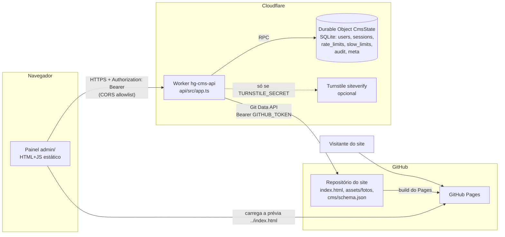

<!-- generated-by: gsd-doc-writer -->
# Painel (CMS) do site HG Transportes: documentação técnica

Esta documentação é para quem vai avaliar, manter ou colocar em produção o painel de edição do site
da HG Transportes. Tudo que está aqui foi conferido no código do repositório. O que ainda não foi
decidido aparece marcado como **A CONFIRMAR**.

## Índice

| Documento | Conteúdo |
| --- | --- |
| [api.md](api.md) | Referência das rotas do Worker: pedido, resposta e códigos de erro |
| [regras-de-negocio.md](regras-de-negocio.md) | Regras de negócio (papéis, senha, sessão, limites, conflito etc.) e o teste que cobre cada uma |
| [operacao.md](operacao.md) | Runbook: primeiro usuário, reset de senha, rotação de token e pepper, restauração, logs, queda do Worker |
| [seguranca/ameacas-stride.md](seguranca/ameacas-stride.md) | Modelo de ameaças STRIDE por componente, mitigações com prova no código e riscos residuais |
| [adr/0001-pages-mais-worker.md](adr/0001-pages-mais-worker.md) | ADR 1: GitHub Pages + Cloudflare Worker |
| [adr/0002-durable-object-sqlite.md](adr/0002-durable-object-sqlite.md) | ADR 2: Durable Object SQLite para estado |
| [adr/0003-pbkdf2-com-pepper.md](adr/0003-pbkdf2-com-pepper.md) | ADR 3: PBKDF2-SHA256 + pepper |
| [adr/0004-sessao-opaca-em-header.md](adr/0004-sessao-opaca-em-header.md) | ADR 4: sessão por token opaco no header `Authorization` |
| [adr/0005-commit-atomico-git-data-api.md](adr/0005-commit-atomico-git-data-api.md) | ADR 5: commit atômico via Git Data API com conflito por campo |
| [adr/0006-edicao-cirurgica-por-marcadores.md](adr/0006-edicao-cirurgica-por-marcadores.md) | ADR 6: edição cirúrgica por marcadores `data-cms` + esquema |
| [adr/0007-recuperacao-e-pepper-versionado.md](adr/0007-recuperacao-e-pepper-versionado.md) | ADR 7: pepper com versão por usuário e recuperação de admin por segredo efêmero |

Antes de ir para produção, veja [Decisões pendentes antes de produção](#decisões-pendentes-antes-de-produção).

O resumo do código, arquivo por arquivo, fica em [`api/README.md`](../api/README.md).

## Visão geral

O site é um único `index.html` estático, servido pelo GitHub Pages. O painel (`admin/`) também é
estático e fica no mesmo Pages. Ele não tem nenhum segredo e não fala com o GitHub: conversa só com
uma API em **Cloudflare Worker** (`api/`, TypeScript strict). O Worker é o único componente que
guarda o token do GitHub.

Para publicar, o Worker cria **um commit** no branch do site pela Git Data API. O GitHub Pages
republica o site a partir desse commit. Usuários, sessões, limite de tentativas e auditoria ficam num
**Durable Object SQLite** (`CmsState`), com uma única instância global (`idFromName('global')`, em
`api/src/app.ts`).



Fluxo de uma publicação (detalhes em [ADR 5](adr/0005-commit-atomico-git-data-api.md)):

1. O painel chama `GET /content` e recebe `{html, commit, schemaVersion, fields}`. O `commit` (SHA do
   HEAD) vira a `base` do rascunho; `fields` traz tipo e limite de cada campo.
2. O painel envia `POST /publish {base, changes, images, expected}` (`expected` = o valor publicado que ele
   mostrava em cada campo enviado).
3. O Worker lê o HEAD, o `index.html` e o `cms/schema.json` **do mesmo commit**, confere os marcadores
   contra o esquema, valida cada valor pelo tipo, confere `expected` contra o HEAD e, se a base for antiga,
   verifica conflito campo a campo. Se outra pessoa mudou outros campos, faz rebase e responde
   `rebased`/`othersChanged`, e o painel recarrega o conteúdo e avisa.
4. O Worker aplica a edição cirúrgica, confere o resultado e cria blobs (fotos e `index.html`), tree,
   commit e `PATCH` do ref com `force: false`. Se o branch andou no meio, tenta de novo (até 3 vezes no total).
5. O GitHub Pages republica o site. O tempo até o site público refletir o commit depende do Pages
   (**A CONFIRMAR**: não há medição no repositório).

### Componentes

| Componente | Onde | Papel |
| --- | --- | --- |
| Site público | `index.html`, `assets/` | Página única com marcadores `data-cms` nos trechos editáveis (98 campos em `cms/schema.json`) |
| Esquema | `cms/schema.json` | Lista versionada dos campos editáveis (chave, tipo, grupo, rótulo, limite). Gerado por `api/scripts/gerar-schema.mjs` |
| Painel | `admin/index.html`, `admin/admin.js`, `admin/rules.js`, `admin/admin.css`, `admin/config.js` | Front estático em JS puro, sem build. Edição por campo com prévia ao vivo em iframe. `rules.js` tem as mesmas regras de campo do servidor |
| API | `api/src/*.ts` | Worker: roteamento, CORS, autenticação, validação, publicação |
| Estado | `api/src/state.ts` | Durable Object SQLite `CmsState` |
| CI | `.github/workflows/cms.yml`, `.github/dependabot.yml` | Validação de marcadores, esquema em dia, typecheck, lint, formatação e testes em todo push e PR; actions fixadas por SHA, atualizadas pelo Dependabot |

### Front (nível de arquitetura)

- **Sem build e sem segredo.** `admin/config.js` é público e só define a URL da API, a chave pública do
  Turnstile e os limites de upload espelhados do servidor.
- **CSP via `<meta>`** em `admin/index.html` (o GitHub Pages não permite cabeçalho). O arquivo versionado
  tem **só a CSP de produção**: `default-src 'none'`; `script-src` pelo **caminho** do painel
  (`https://joaostx1999.github.io/hg-transportes-site/admin/`) e o Turnstile; `connect-src 'self'` + o
  **host exato** do Worker (o mesmo do `apiBase` em `config.js`, sem curinga); `base-uri 'none'`;
  `form-action 'none'`. O ambiente local serve uma cópia gerada por `api/dev/build-admin-dev.mjs`
  (o `start-dev.sh` chama) com `script-src` local e `http://127.0.0.1:8787` no `connect-src`; o gerador
  falha se a CSP de produção tiver host local.
- **Sessão só na aba.** O token fica em `sessionStorage` e vai no header `Authorization: Bearer`.
- **Rascunho por usuário.** Fica em `localStorage` (`hg-cms-draft:<usuário>`) com a base e o valor publicado
  que a pessoa via. Sobrevive a uma sessão expirada (para a mesma pessoa); o botão **Sair** descarta. Ao
  repor, um campo que o site mudou desde então fica em **conflito visível** até a pessoa escolher.
- **Mesma regra de campo do servidor.** `admin/rules.js` decide se um campo mudou (forma canônica) e valida
  como o servidor; o limite vem do `/content`. Um teste roda os dois lados nos mesmos valores.
- **Leitura inerte do HTML.** O HTML vindo do `/content` é lido com `DOMParser`, e os dados entram na tela
  por `textContent` e atributos.
- **Prévia.** Um iframe com `sandbox="allow-same-origin"` (sem `allow-scripts`) carrega `../index.html` do
  próprio Pages: o painel mexe no DOM da prévia, mas o JS do site não roda dentro do painel. Como o Pages
  pode estar atrasado em relação ao HEAD, o painel iguala o DOM da prévia ao HTML do servidor e aplica o
  rascunho por cima.
- **Fotos.** Antes do envio, o navegador redesenha a imagem num `canvas`, o que reduz o tamanho e
  re-encoda o arquivo. O servidor não re-encoda, mas remove metadados (EXIF/GPS, XMP, textos) e bytes
  depois do fim de qualquer foto que receber.
- **Anti-framing.** O painel sai de qualquer iframe que tente embuti-lo (redireciona `window.top`).
- **Modo "Só testar, sem publicar".** Existe um botão na tela de login para usar o editor sem sessão (sem
  rascunho guardado).

> O front está em ajuste. Esta seção descreve só a arquitetura; detalhes de UI podem mudar.

## Como rodar localmente

O ambiente local nunca toca no GitHub nem na Cloudflare reais. Um **GitHub falso**
(`api/dev/github-mock.mjs`) implementa o subconjunto da API usado pelo Worker sobre um repositório
git de verdade em `api/.dev-repo`, que fica fora do git do site (`.gitignore`).

### Pré-requisitos

- Node `>= 22.18` (`api/package.json` → `engines`). `api/.nvmrc` fixa a major `22`. O
  `start-dev.sh` recusa versões abaixo de 22.18, porque os scripts rodam `.ts` direto, com a remoção
  de tipos nativa do Node.
- `git`, `python3` e `lsof` no PATH (usados pelo `start-dev.sh`).

### Passos

```bash
cd api
nvm use            # lê api/.nvmrc (22)
npm ci
dev/start-dev.sh   # sobe mock (8788), Worker (8787) e site + painel (8781)
```

| Porta | Serviço |
| --- | --- |
| 8788 | GitHub falso sobre `api/.dev-repo` |
| 8787 | `wrangler dev`, com o estado do Durable Object em `api/.wrangler/state` |
| 8781 | `python3 -m http.server` servindo `api/.dev-repo` (site publicado no mock) e `/admin` (`api/.dev-admin`: `index.html` com a CSP de dev + links para os arquivos do `admin/` real) |

O `start-dev.sh` cria `api/.dev.vars` (com permissão `600`) se o arquivo não existir, e completa as chaves
que faltarem. Ele gera um `PASSWORD_PEPPER` e um `BOOTSTRAP_SECRET` aleatórios, aponta `GITHUB_API_BASE`
para o mock com `DEV_ALLOW_LOCAL_GITHUB=1` (sem essa flag o Worker recusa qualquer base que não seja
`https://api.github.com`) e põe `http://127.0.0.1:8781` e `http://localhost:8781` em `ALLOWED_ORIGINS`. O
modelo está em `api/.dev.vars.example`. Depois de mudar o `admin/index.html`, reinicie o ambiente (ou rode
`node dev/build-admin-dev.mjs`) para regenerar a cópia de dev.

Primeiro usuário local (o segredo é lido de `api/.dev.vars`):

```bash
HG_SENHA='uma-senha-forte-local' node scripts/criar-usuario.mjs admin
```

Depois abra `http://127.0.0.1:8781/admin/`.

Opções e encerramento:

```bash
dev/start-dev.sh --reset         # recria api/.dev-repo a partir do site real
dev/start-dev.sh --reset-state   # apaga usuários, sessões e auditoria locais
dev/stop-dev.sh                  # derruba só os PIDs registrados em api/.dev-logs/pids
```

Logs locais: `api/.dev-logs/mock.log`, `wrangler.log` e `http.log`.

## Testes e verificações

Tudo roda dentro de `api/`:

```bash
npm run check   # validar-marcadores + typecheck + lint + format:check + test
npm test        # só a suíte (vitest run)
```

O `api/vitest.config.ts` define dois projetos:

- **`workers`** (`test/worker/**/*.test.ts`): roda no runtime real do Workers (workerd via
  `@cloudflare/vitest-plugin`), com o Durable Object e os bindings do `wrangler.toml`. O GitHub é
  simulado em memória por `test/worker/fake-github.ts`. O plugin também lê o `api/.dev.vars`, mas os
  bindings de teste do `vitest.config.ts` sobrepõem tudo que importa (inclusive os secrets opcionais,
  vazios), então o resultado não depende da máquina.
- **`node`** (`test/node/**/*.test.ts`): roda o mock git, a publicação real contra o mock, os scripts, a
  forma do workflow de CI, a CSP de produção x dev e a paridade das regras do painel (`admin/rules.js`)
  com as do servidor.

E2E no navegador (Chromium via `playwright-core`), contra o ambiente local completo, subindo e derrubando
tudo sozinho (portas 8781, 8787 e 8788):

```bash
npm run e2e                     # 14 cenários; resumo em api/e2e/ultimo-resultado.txt
HG_E2E_ONLY=1,3 npm run e2e     # só alguns cenários (diagnóstico)
```

Depois de mexer em marcadores `data-cms` do `index.html`, regenere o esquema:

```bash
npm run gerar-schema
node scripts/gerar-schema.mjs --check   # o mesmo teste que a CI roda
```

### CI

`.github/workflows/cms.yml` roda em todo `push` e `pull_request`. Usa `permissions: contents: read`,
checkout sem credenciais persistidas e Node 22. As actions estão fixadas por SHA (com a versão em
comentário: `actions/checkout` v4.2.2 e `actions/setup-node` v4.2.0); o `.github/dependabot.yml` propõe
atualizações semanais de npm (`/api`) e das actions. Os passos são: `npm ci`, `validar-marcadores`,
`gerar-schema --check`, `typecheck`, `lint`, `format:check` e `npm test`. A CI **não faz deploy** do Worker
e não roda o E2E (precisa de Chromium e do ambiente local).

## Checklist de deploy em produção

Nenhum deploy foi feito a partir deste repositório. Os passos abaixo seguem o que o código espera
(`api/wrangler.toml`, `api/src/env.ts`, `api/scripts/criar-usuario.mjs`). Cada decisão em aberto está
marcada.

### Decisões A CONFIRMAR antes do deploy

| # | Decisão | Onde impacta |
| --- | --- | --- |
| 1 | **Conta Cloudflare**: de quem é, plano e quem tem acesso | `wrangler login` e `wrangler deploy` |
| 2 | **Token GitHub**: quem gera, em qual conta, qual validade e quem renova | secret `GITHUB_TOKEN`; aviso no painel com menos de 30 dias |
| 3 | **URL do Worker** (`*.workers.dev` ou domínio próprio) | `admin/config.js` (`apiBase`, hoje o placeholder `https://hg-cms-api.seu-subdominio.workers.dev`) e o mesmo host exato no `connect-src` da CSP em `admin/index.html` (mudam juntos) |
| 4 | **Turnstile**: usar ou não | secret `TURNSTILE_SECRET` + `turnstileSiteKey` em `admin/config.js` (hoje vazio) |
| 5 | **Primeiro admin**: quem é e quem guarda a senha | `POST /bootstrap` via `scripts/criar-usuario.mjs` |
| 6 | **Domínio do site e do painel** | `ALLOWED_ORIGINS` em `wrangler.toml` (hoje `https://joaostx1999.github.io`). Não há `CNAME` no repositório |
| 7 | **Conta/owner do repositório** em produção | `GITHUB_OWNER` (`Joaostx1999`), `GITHUB_REPO` e `GITHUB_BRANCH` (`main`) em `wrangler.toml` |
| 8 | **GitHub Pages** publicando a partir de `main` (raiz) | configuração do repositório no GitHub; não é verificável no código |

### Passos

1. **Token GitHub fine-grained** (decisão 2), restrito a este repositório, com permissão
   **Contents: Read and write** e data de validade. O Worker usa `git/ref`, `git/refs`, `git/commits`,
   `git/trees`, `git/blobs`, `contents` e `commits` (`api/src/github.ts`).
   <!-- VERIFY: Contents RW basta para todos esses endpoints da Git Data API num fine-grained token -->
2. **Conferir `api/wrangler.toml`**: `GITHUB_OWNER`, `GITHUB_REPO`, `GITHUB_BRANCH`, `ALLOWED_ORIGINS`
   (decisões 6 e 7). `ALLOWED_ORIGINS` compara a origem exata (esquema + host + porta, sem caminho).
3. **Login e deploy** (decisão 1):
   ```bash
   cd api
   npx wrangler login
   npx wrangler deploy
   ```
   A migração `v1` (`new_sqlite_classes = ["CmsState"]`) cria a classe do Durable Object.
4. **Secrets** (nunca no `wrangler.toml` nem no git):
   ```bash
   npx wrangler secret put GITHUB_TOKEN       # obrigatório
   npx wrangler secret put PASSWORD_PEPPER    # obrigatório, >= 32 caracteres (api/src/password.ts)
   npx wrangler secret put BOOTSTRAP_SECRET   # >= 32 caracteres; só até criar o primeiro admin
   npx wrangler secret put TURNSTILE_SECRET   # opcional (decisão 4)
   ```
   Para gerar um pepper forte, por exemplo: `node -e "console.log(require('crypto').randomBytes(48).toString('base64url'))"`.
   Sem `PASSWORD_PEPPER` (ou com menos de 32 caracteres), login e criação de usuário respondem
   `500 server`, falhando fechado.
5. **Health check**:
   ```bash
   curl https://<url-do-worker>/health    # {"ok":true,"version":"3.0.0","time":"..."}
   ```
6. **Primeiro admin** (decisão 5):
   ```bash
   HG_BOOTSTRAP_SECRET='<mesmo valor do secret>' \
     node scripts/criar-usuario.mjs <usuario> --url https://<url-do-worker>
   npx wrangler secret delete BOOTSTRAP_SECRET   # obrigatório: não deixe o secret configurado
   ```
   Em seguida, crie um **segundo admin** pelo painel (de outra pessoa).
7. **Front**: em `admin/config.js`, troque `apiBase` pela URL do Worker (decisão 3) e troque o **mesmo
   host** no `connect-src` da CSP em `admin/index.html` (sem curinga). Se o painel sair de
   `joaostx1999.github.io/hg-transportes-site/`, ajuste também o `script-src` (caminho do painel) e o
   `PROD_SCRIPT_SRC` de `api/dev/build-admin-dev.mjs`. Se for usar Turnstile,
   preencha `turnstileSiteKey` **junto** com o secret `TURNSTILE_SECRET`: com só um dos dois, o login
   recusa todo mundo ou fica sem verificação.
8. **Commit e push** de `admin/config.js` (e da CSP, se mudou) para o branch publicado pelo Pages.
9. **Teste de fumaça**: entrar no painel, conferir que o admin vê o aviso de validade do token quando
   faltam menos de 30 dias, publicar uma alteração pequena, conferir o commit no GitHub e restaurar
   pela tela de versões.

Procedimentos do dia a dia (rotação de token e pepper, reset de senha, logs) estão em [operacao.md](operacao.md).

## Variáveis e secrets

| Nome | Tipo | Padrão no código | Uso |
| --- | --- | --- | --- |
| `GITHUB_TOKEN` | secret | — | Token do GitHub. Sem ele, rotas que tocam no GitHub dão `500 server` (`ConfigError`) |
| `PASSWORD_PEPPER` | secret | — | Chave HMAC aplicada antes do PBKDF2. Mínimo de 32 caracteres |
| `PASSWORD_PEPPER_PREV` | secret (efêmero) | — | Pepper anterior, só durante a rotação (re-hash no login). Apagar depois |
| `PASSWORD_PEPPER_ID` / `PASSWORD_PEPPER_PREV_ID` | var | `1` / — | Versão do pepper atual e do anterior (gravada em cada hash) |
| `BOOTSTRAP_SECRET` | secret (efêmero) | — | Habilita `POST /bootstrap` (>= 32 caracteres, senão 403). Apagar depois do 1º admin |
| `RECOVERY_SECRET` | secret (efêmero) | — | Habilita `POST /recover` (>= 32, uso único por valor). Só durante uma recuperação |
| `TURNSTILE_SECRET` | secret | — | Se existir, `/login` exige `turnstileToken` (e dispensa o atraso progressivo) |
| `GITHUB_OWNER` / `GITHUB_REPO` / `GITHUB_BRANCH` | var | — / — / `main` | Repositório de destino |
| `GITHUB_API_BASE` | var | `https://api.github.com` | Só aceita `https://api.github.com`. Outro valor só com host `127.0.0.1`/`localhost` **e** `DEV_ALLOW_LOCAL_GITHUB=1` (mock do dev); senão `500 server` |
| `DEV_ALLOW_LOCAL_GITHUB` | var (só dev) | — | `1` libera o mock local. Fica só no `api/.dev.vars`; nunca em produção |
| `ALLOWED_ORIGINS` | var | vazio (nenhuma origem) | Lista separada por vírgula, comparação exata |
| `SITE_PAGE` | var | `index.html` | Página editada |
| `SCHEMA_PATH` | var | `cms/schema.json` | Esquema lido do mesmo commit |
| `SESSION_IDLE_SECONDS` | var | `3600` | Expiração por inatividade |
| `SESSION_MAX_SECONDS` | var | `43200` | Expiração absoluta |
| `MAX_UPLOAD_BYTES` | var | `3145728` | Tamanho máximo de cada foto decodificada |
| `PBKDF2_ITERATIONS` | var | `100000` | Limitado por `clampIterations` a 10.000–100.000 (abaixo de 10.000 volta para 100.000) |

O diretório de fotos não é configurável: está fixo em `api/src/publish.ts` (`PHOTOS_DIR = 'assets/fotos'`)
e em `IMAGE_PATH_RE` (`api/src/validate.ts`).

## Decisões pendentes antes de produção

Estas decisões ficam com o responsável pelo projeto. O código funciona sem elas, mas cada uma muda o risco
residual descrito no [STRIDE](seguranca/ameacas-stride.md). Todas estão **A CONFIRMAR**.

| # | Decisão | Situação hoje | Recomendação |
| --- | --- | --- | --- |
| 1 | **MFA (TOTP) para admin** | Login só com usuário e senha (R8). As ações sobre usuários pedem a senha de novo, mas não há segundo fator | Ligar TOTP pelo menos para admins antes de produção: segredo por usuário no DO (cifrado com uma chave em secret), código de 6 dígitos no login de admin, códigos de recuperação de uso único. Não está implementado |
| 2 | **Domínio próprio do painel** (R1) | Painel em `joaostx1999.github.io/hg-transportes-site/admin/`: a origem é compartilhada com qualquer outro repositório Pages da conta (CORS e `localStorage`); a CSP compensa só no `script-src` (por caminho) | Servir o painel num subdomínio só dele (ex.: `painel.<dominio-da-hg>`), pôr esse origin exato em `ALLOWED_ORIGINS`, e trocar o `script-src` por `'self'` desse host |
| 3 | **Escopo do token do GitHub** (R9) | Fine-grained, Contents RW num repositório: escreve em qualquer arquivo, inclusive `admin/` | Token fine-grained só deste repositório, Contents RW, validade de 90 dias com dono definido para renovar; proteção de branch exigindo a CI verde e, se possível, separar o site do painel em repositórios diferentes para o token não alcançar o código do painel |
| 4 | **Turnstile** | Desligado (`turnstileSiteKey` vazio, sem `TURNSTILE_SECRET`). Sem ele, valem os limites por rede e o atraso progressivo por usuário | Ligar em produção (secret + sitekey juntos): corta bots no login e dispensa o atraso progressivo para humanos. Custo: login por `curl` deixa de funcionar (use o token do painel) |
| 5 | **Retenção do IP na auditoria (LGPD)** | IP completo guardado 365 dias em toda entrada da auditoria | Definir base legal (segurança/legítimo interesse) e prazo; recomendação: 90 dias para o IP (ou truncar para /24 e /48 depois de 30 dias), mantendo o resto da auditoria por 365 dias. Registrar no aviso de privacidade do painel |
| 6 | **Backup do Durable Object** | Sem exportação automática; perder o DO apaga usuários e auditoria (a recuperação de admin ajuda só se o DO existir) | Exportar periodicamente `GET /users` e `GET /audit` (script com token de admin, guardado fora da Cloudflare) e documentar a restauração; avaliar o Point-in-Time Recovery do DO SQLite <!-- VERIFY: disponibilidade e janela do PITR de Durable Objects SQLite no plano usado --> |
