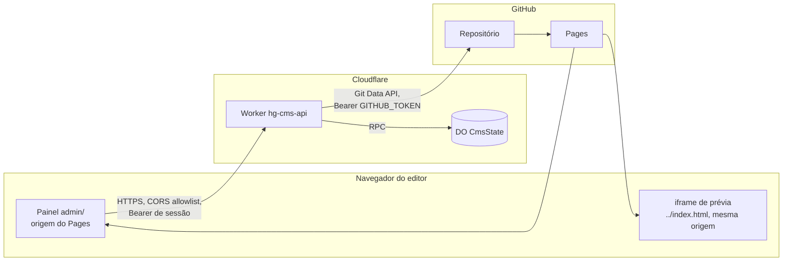

<!-- generated-by: gsd-doc-writer -->
# Modelo de ameaças (STRIDE) do painel

Este documento lista, componente por componente, o que pode dar errado em cada categoria STRIDE
(**S**poofing, **T**ampering, **R**epudiation, **I**nformation disclosure, **D**enial of service,
**E**levation of privilege). Também traz a mitigação que existe hoje e a prova no código ou no teste.
Os testes são citados como `arquivo › "nome do teste"` e ficam em `api/test/`. O que não tem prova no
repositório aparece como **A CONFIRMAR** ou como risco residual.

Visão geral da arquitetura: [README](../README.md). Rotas e códigos de erro: [api.md](../api.md).
Regras com o teste de cada uma: [regras-de-negocio.md](../regras-de-negocio.md). Procedimentos:
[operacao.md](../operacao.md).

## Situação depois da revisão de código e de segurança

Não há mais itens "em correção". O que a revisão apontou foi corrigido com teste (lista completa, com o
teste de cada item, em [regras-de-negocio.md](../regras-de-negocio.md)):

| Item | Situação |
| --- | --- |
| `PHOTOS_DIR` declarado e não lido; `api/README.md` descrevendo `src/index.ts` como roteador | já corrigidos no código (a variável saiu do `wrangler.toml`; o README descreve `src/app.ts`) |
| Testes de `MAX_CHANGES` (V14) e do papel editor publicando e restaurando (P2) | existem |
| CSP do painel ampla demais (antigo R3) | corrigido: host exato do Worker, `script-src` pelo caminho do painel, sem `127.0.0.1` no arquivo de produção |
| Prévia executando o site na origem do painel (antigo R2) | corrigido: iframe `sandbox="allow-same-origin"` sem `allow-scripts` |
| `/restore` aceitando qualquer SHA (S1) | corrigido: só versões do histórico do branch |
| `/users/*` sem prova extra (S3) | corrigido: senha atual do admin + limite de tentativas |
| Limite por IP fácil de contornar com IPv6 e sem limite global (S4, antigo R6) | corrigido: /64 e atraso progressivo por usuário |
| Texto digitado gravado na auditoria (S5) | corrigido: só `invalid_username: true` |
| Lista curta de senhas comuns (S7) | corrigido: 10 mil senhas vazadas embutidas |
| `BOOTSTRAP_SECRET` sem tamanho mínimo (S8) | corrigido: >= 32, senão falha fechada |
| `GITHUB_API_BASE` livre (S9) | corrigido: só `https://api.github.com` (mock só com flag de dev) |
| Fotos com metadados (S10, antigo R4) | reduzido: metadados e bytes depois do fim são removidos no servidor; sem re-encode |
| Actions do CI por tag (S11) | corrigido: fixadas por SHA + Dependabot |
| Pepper único e sem recuperação (R10) | corrigido: `pepper_id` por usuário e `/recover` com `RECOVERY_SECRET` efêmero ([ADR 0007](../adr/0007-recuperacao-e-pepper-versionado.md)) |

O que continua aberto são **decisões** (domínio próprio, MFA, escopo do token, Turnstile, LGPD, backup),
listadas em [Decisões pendentes antes de produção](../README.md#decisões-pendentes-antes-de-produção).

## Escopo, ativos e limites de confiança

### Ativos

| Ativo | Onde fica | Quem acessa |
| --- | --- | --- |
| `GITHUB_TOKEN` (escrita no repositório) | secret do Worker | só o Worker, só para `GITHUB_API_BASE` (`api/src/github.ts`) |
| `PASSWORD_PEPPER` | secret do Worker | só o Worker (`api/src/password.ts`) |
| `PASSWORD_PEPPER_PREV` (só durante rotação) | secret do Worker | só o Worker |
| `BOOTSTRAP_SECRET`, `RECOVERY_SECRET` (efêmeros), `TURNSTILE_SECRET` | secrets do Worker | só o Worker |
| Hashes de senha, sessões, limites, auditoria | Durable Object `CmsState` (SQLite), instância única `idFromName('global')` | só o Worker, por RPC |
| Token de sessão do usuário | `sessionStorage` (chave `hg-cms-session`) da aba do painel | scripts da origem do painel |
| Rascunho não publicado | `localStorage` (chave `hg-cms-draft:<usuário>`) da origem do painel | scripts da origem do painel |
| Conteúdo do site | `index.html`, `assets/fotos/`, `cms/schema.json` no branch `main` | quem escreve no repositório e o Worker |

### Limites de confiança

- **Navegador → Worker.** Tudo que chega do navegador é não confiável. O Worker revalida tudo.
- **Worker → GitHub.** As respostas do GitHub são tratadas como dados. Formato inesperado vira
  `GitHubError` (`api/src/github.ts`), e falha vira `502 upstream`.
- **Repositório → painel.** O HTML do site é lido pelo painel com `DOMParser`, que cria um documento
  inerte. O iframe de prévia carrega o `index.html` publicado com `sandbox="allow-same-origin"` **sem**
  `allow-scripts`: o painel consegue mexer no DOM da prévia, mas nenhum script do site roda ali (veja
  [R2](#r2-prévia-na-origem-do-painel-sem-scripts)).
- **Fora do escopo:** a segurança das contas GitHub e Cloudflare em si, o navegador e o sistema do editor,
  e a infraestrutura do GitHub Pages.

## Ameaças por componente

### 1. Painel (`admin/`, estático no Pages)

| STRIDE | Ameaça | Mitigação | Prova |
| --- | --- | --- | --- |
| I / E | XSS no painel rouba o token de sessão de `sessionStorage` | CSP via `<meta>` sem `'unsafe-inline'`. `script-src` restrito ao **caminho** do painel (`https://joaostx1999.github.io/hg-transportes-site/admin/`) e ao Turnstile: `'self'` liberaria scripts de qualquer outro repositório publicado no mesmo host. Dados externos entram por `textContent` e atributos. O HTML do `/content` é lido com `DOMParser` | `scripts.test.ts` › "admin/index.html versionado tem só a CSP de produção: sem 127.0.0.1/localhost/http:, script-src por caminho"; E2E cenário 1 (CSP aplicada) e "nenhum erro de JavaScript nem de CSP no navegador" |
| I | O painel envia dados (token, conteúdo) para um host que não é o Worker | `connect-src 'self'` + o **host exato** do Worker de produção (o mesmo do `apiBase` em `config.js`, sem curinga). O arquivo versionado não tem `127.0.0.1`: o dev serve uma cópia gerada por `api/dev/build-admin-dev.mjs`, que falha se a CSP de produção tiver host local | `scripts.test.ts` › "a cópia de dev troca só script-src (caminho local) e soma o Worker local ao connect-src"; E2E cenário 1 |
| E | Script do site publicado roda dentro do painel pela prévia | iframe `sandbox="allow-same-origin"` sem `allow-scripts` | E2E cenário 3 (atributo, `html` sem a classe `.js` que o script do site põe, conteúdo `.rv` visível) |
| T | Clickjacking: outro site embute o painel num iframe e induz cliques | O painel redireciona `window.top` se estiver dentro de um iframe. A CSP por `<meta>` não aceita `frame-ancestors`, e o Pages não deixa configurar cabeçalho | `admin/admin.js` (`if (window.top !== window.self)`). **Sem teste automatizado** |
| S | Página falsa imitando o painel captura a senha | Nenhuma no código (não há MFA nem chave de hardware). O Turnstile, se ligado, não impede phishing | — (risco residual [R8](#r8-sem-segundo-fator)) |
| I / T | Rascunho de uma pessoa aparece (e é publicado) por outra no mesmo navegador | Chave por usuário com `{user, base, values, originals}`; **Sair** descarta; sessão vencida guarda só para o dono; ao repor, campo mudado no site desde o rascunho fica em conflito visível | E2E cenário 11 (a) e (b), cenário 6 |
| I | Configuração pública expõe segredo | `admin/config.js` só tem URL da API, chave **pública** do Turnstile e limites | `admin/config.js` |

### 2. Borda HTTP do Worker (`api/src/app.ts`, `api/src/http.ts`)

| STRIDE | Ameaça | Mitigação | Prova |
| --- | --- | --- | --- |
| S | Outro site chama a API com a sessão do usuário (CSRF) | A sessão não usa cookie: o token vai no header `Authorization`, que outro site não consegue anexar. CORS com comparação exata de origem. Pedido sem `Origin` é recusado, exceto `/health` e `/bootstrap` | `api-auth.test.ts` › "origem não listada: 403 cors sem ACAO, inclusive no preflight e em /health", "sem Origin: 403 (o painel sempre manda), exceto /health e /bootstrap" |
| S | Página de outra origem que compartilha `*.github.io` passa no CORS | `ALLOWED_ORIGINS` é a origem inteira `https://joaostx1999.github.io`, sem caminho | risco residual [R1](#r1-origem-githubio-compartilhada) |
| D | Corpo gigante esgota memória ou CPU | Limites por rota lidos do stream (4 KB, 64 KB, 12 MB), e não só do `Content-Length`. O `413` do `/publish` sai antes de chamar o GitHub | `api-auth.test.ts` › "limites de corpo por rota: login 4 KB, JSON comum 64 KB; JSON inválido e Content-Type"; `api-content.test.ts` › "corpo acima de 12 MB: 413 antes de qualquer chamada ao GitHub" |
| T | JSON malformado, UTF-8 inválido ou tipo errado confunde as rotas | `Content-Type: application/json` obrigatório, UTF-8 estrito, objeto na raiz | `api-auth.test.ts` › "limites de corpo por rota…" |
| I | Resposta da API é guardada em cache ou interpretada como HTML | Cabeçalhos em toda resposta: `Cache-Control: no-store`, `nosniff`, CSP `default-src 'none'; frame-ancestors 'none'`, `X-Frame-Options: DENY`, HSTS, COOP | `api-auth.test.ts` › "preflight de origem permitida: 204 com cabeçalhos exatos e de segurança", "rota e método inexistentes; erro também leva cabeçalhos de segurança"; `entry.test.ts` › "GET /health pelo fetch real do Worker, com cabeçalhos de segurança" |
| I | Mensagem de erro vaza detalhe interno (token, stack, motivo da falha) | `toHttpError` converte tudo em mensagem genérica. O log guarda só o nome do erro ou `github_<status>` | `api-content.test.ts` › "GitHub fora do ar ou 500: 502 upstream genérico, sem vazar token"; `api-auth.test.ts` › "sem PASSWORD_PEPPER o login falha fechado (500) sem vazar o motivo" |
| I | Log grava senha, token ou conteúdo | `logLine` só emite campos de uma lista fechada (`ALLOWED` em `api/src/log.ts`) | `api-auth.test.ts` › "logs JSON estruturados sem senha, token, pepper ou corpo" |

### 3. Autenticação e sessão (`app.ts`, `password.ts`, `state.ts`, `turnstile.ts`)

| STRIDE | Ameaça | Mitigação | Prova |
| --- | --- | --- | --- |
| S | Força bruta e credential stuffing no `/login` | 5 falhas por usuário+IP e 20 por IP em 15 min bloqueiam por 15 min. A tentativa é reservada **antes** de verificar a senha. Turnstile opcional | `api-auth.test.ts` › "5 falhas por usuário+IP bloqueiam…", "20 falhas por IP (usuários variados) bloqueiam o IP inteiro", "atômico: 12 tentativas simultâneas erradas fazem no máximo 5 verificações; o resto é 429" |
| S | Força bruta distribuída em muitos IPs (ou trocando de endereço dentro do mesmo /64 IPv6) contra um usuário | Chave de rede com IPv6 por /64. Contador global por usuário: passou de 50/h, atraso progressivo de 1 s a 30 s por tentativa (dispensado com Turnstile verificado). Não trava a conta (um atacante não tranca o dono) | `api-auth.test.ts` › "trocar de endereço dentro do mesmo /64 não zera o limite por usuário+IP", "50 falhas/h de IPs diferentes: a partir daí atraso progressivo, sem travar a conta", "com Turnstile ligado, o token verificado dispensa o atraso progressivo"; residual em [R6](#r6-limites-de-tentativa-por-rede) |
| I | Enumeração de usuários pela resposta ou pelo tempo | Mesma resposta para usuário inexistente e senha errada. PBKDF2 contra um registro `DUMMY` iguala o tempo. Comparação em tempo constante | `api-auth.test.ts` › "senha errada e usuário inexistente: mesma resposta genérica"; `api/src/password.ts` (`DUMMY`, `timingSafeEqual`) |
| I | Vazamento do DO permite quebrar senhas offline | HMAC com pepper (só no secret) antes do PBKDF2-SHA256 de 100.000 iterações, sal de 16 bytes por usuário. Detalhes no [ADR 0003](../adr/0003-pbkdf2-com-pepper.md) | `password.test.ts` › "o pepper entra no cálculo: sem ele (ou com outro) a senha não confere", "hash: sal de 16 bytes por usuário, 32 bytes, 100000 iterações" |
| E | Pepper ausente ou curto faz o Worker aceitar senha sem pepper | `PepperError` responde `500 server` (falha fechada) | `password.test.ts` › "pepper ausente ou curto: recusa (falha fechada)" |
| S | Roubo do token de sessão | Token opaco de 256 bits. O DO guarda só o SHA-256. Expiração de 1 h por inatividade e de 12 h absoluta. Logout apaga no servidor. Login com o token antigo revoga o antigo | `api-auth.test.ts` › "o DO guarda só o hash do token", "sessão expira por inatividade (1 h)…", "sessão expira por tempo absoluto (12 h)…", "rotação: login com o token antigo no Authorization invalida o antigo" |
| S | Sessão continua válida depois da troca de senha | Trocar a própria senha derruba as **outras** sessões. A redefinição por admin derruba **todas** as sessões do alvo. Remover o usuário apaga as sessões dele | `api-users.test.ts` › "troca certa invalida as OUTRAS sessões; a atual continua; senha velha não entra mais", "admin redefine a senha de outro: todas as sessões dele caem" |
| E | Tomada do painel pelo `/bootstrap` depois que já existem usuários | O `/bootstrap` só funciona com `BOOTSTRAP_SECRET` configurado (**>= 32 caracteres**, senão falha fechada) **e** o DO vazio, numa transação. O segredo é comparado em tempo constante. Limite de 20 falhas por IP. O secret deve ser apagado depois | `api-users.test.ts` › "S8: BOOTSTRAP_SECRET com menos de 32 caracteres: 403 mesmo com o segredo certo", "sem BOOTSTRAP_SECRET: sempre 403", "força bruta no segredo: 20 erros por IP bloqueiam"; `state.test.ts` › "bootstrap atômico…" |
| E | Recuperação de admin vira porta permanente | `/recover` só com `RECOVERY_SECRET` (>= 32) definido, tempo constante, 5 tentativas por rede em 15 min, auditado e de **uso único** por valor; só redefine admin existente | `recover.test.ts` (todos os testes de "POST /recover") |
| I | Vazamento do pepper obriga a zerar todos os usuários | `pepper_id` por usuário e `PASSWORD_PEPPER_PREV` durante a rotação: re-hash transparente no login | `recover.test.ts` › "rotação: pepper novo + PREV; login com o antigo funciona e re-hasheia com o novo; depois tira o PREV" |
| S | Bot automatiza o login | Turnstile com `siteverify` e `remoteip`, só se `TURNSTILE_SECRET` existir. Usar ou não em produção é **A CONFIRMAR** | `api-auth.test.ts` › "com TURNSTILE_SECRET: exige token, valida no siteverify com remoteip, recusa inválido" |

### 4. Autorização e usuários

| STRIDE | Ameaça | Mitigação | Prova |
| --- | --- | --- | --- |
| E | Editor usa rotas de admin | `auth: 'admin'` na tabela de rotas, checado antes de ler o corpo | `api-users.test.ts` › "editor: rotas de admin negadas (403); edita conteúdo e troca a própria senha" |
| E | Editor publica ou restaura | É permitido por regra (P2) | `api-content.test.ts` › "publish e restore com sessão de editor: commit com o nome dele e auditoria" |
| D | Admin remove todos os admins e o painel fica sem dono | Ninguém remove a si mesmo. O último admin é protegido, mesmo com remoções simultâneas | `api-users.test.ts` › "último admin é protegido mesmo com dois admins removendo um ao outro ao mesmo tempo" |
| E | Admin com sessão roubada cria admin, remove usuário ou redefine senha | `/users/create`, `/users/delete` e `/users/password` exigem a senha atual do admin (`currentPassword`), com o limite de tentativas do login; `/users/password` recusa o próprio usuário (a própria senha só com a atual, em `/password`) | `api-users.test.ts` › "senha do próprio admin nas ações sobre usuários (C4/S3)" (5 testes); E2E cenário 10 |

### 5. Publicação e conteúdo (`publish.ts`, `html-editor.ts`, `schema.ts`, `validate.ts`, `image.ts`)

| STRIDE | Ameaça | Mitigação | Prova |
| --- | --- | --- | --- |
| T | Injeção de HTML ou script no site publicado por um campo de texto | Edição cirúrgica só dentro do trecho do marcador, sempre com escape. `$&` e `$1` não viram padrão. Teste de propriedade com strings hostis aleatórias | `html-editor.test.ts` › "escape: <script> e aspas viram texto…", "$ é texto: $&, $1, $\` e $' não viram padrão de substituição"; `properties.test.ts` › "strings hostis aleatórias nunca criam tag nova nem mexem fora do trecho do campo" |
| T | Link malicioso (`javascript:`, `http:`) num campo `link` | Só `https://`, sem espaço, aspas ou `<>` | `validate.test.ts` › "number, phone, whatsapp, email, link, image" |
| T | Edição fora dos campos marcados ou HTML do HEAD adulterado | O HTML do HEAD tem que conferir com o `cms/schema.json` do **mesmo** commit. O resultado é verificado de novo antes do commit (`IntegrityError` → `422 integrity` com o campo). O fechamento das tags é procurado no texto original (letras como `İ` não deslocam os índices) | `api-content.test.ts` › "HEAD com marcador faltando: 409 schema_mismatch com detalhes; nada é escrito", "o esquema lido é o do MESMO commit…", "verificação de integridade forçada a falhar…", "'"İstanbul" num texto publica certo…'"; `properties.test.ts` (alfabeto com `İ`, `ß`, `fi`…) |
| T | Restaurar como "versão" um commit que nunca foi publicado (PR não mesclado, outro ref) | `/restore` só aceita commit do histórico do branch que tocou o `index.html` | `api-content.test.ts` › "S1: restore só aceita commit do histórico do branch que tocou o index.html; fora: 404"; `github-mock.test.ts` › "S1: restore de commit fora do branch…"; E2E cenário 7 |
| T | Upload de arquivo que não é imagem, ou com caminho escolhido pelo cliente | Bytes mágicos têm que bater com o `type`. Base64 estrito. 3 MiB por foto e 6 por publicação. O caminho é gerado pelo servidor (`assets/fotos/cms-<16 hex>.<ext>`) | `api-content.test.ts` › "fotos inválidas: bytes mágicos falsos, tipo divergente, grande demais (413), tipo não aceito", "fotos vão no MESMO commit do index.html; o servidor gera o caminho" |
| T / I | Foto com EXIF/GPS, XMP, comentários ou arquivo extra colado depois do fim | O servidor remove os segmentos/chunks de metadados e corta bytes depois do EOI/IEND/RIFF; estrutura quebrada é recusada. Não re-encoda | `image.test.ts` (JPEG, PNG, WebP e o `/publish` gravando a foto limpa); residual em [R4](#r4-fotos-sem-re-encode-no-servidor) |
| T | Duas pessoas sobrescrevem a alteração uma da outra | `base` obrigatória, conflito por campo (valor e tipo), `expected` por campo conferido contra o HEAD, `PATCH` do ref com `force: false` e até 3 tentativas; depois de um rebase o painel recarrega e avisa. Detalhes no [ADR 0005](../adr/0005-commit-atomico-git-data-api.md) | `api-content.test.ts` › "outra pessoa mudou o MESMO campo: 409 conflict…", "B4: base já avançada pelo rebase, mas o valor que o painel viu está velho: 409 no campo", "outra pessoa trocou o tipo do campo (phone -> text)…", "corrida entre a leitura e o PATCH…", "branch andando sem parar…"; E2E cenário 8 |
| D | Publicação gigante com muitas chaves | No máximo 200 alterações (`MAX_CHANGES`) | `api-content.test.ts` › "limite de MAX_CHANGES (200) campos por pedido: 200 passa do limite, 201 é recusado antes do GitHub" |
| R | Usuário nega ter feito uma publicação | Cada commit leva autor e committer `<usuário> (painel)`. A auditoria guarda commit, base e valores antigo e novo | `api-content.test.ts` › "muda só o trecho marcado; autor, committer e mensagem do painel; um único commit", "publish e restore entram na auditoria com valor antigo/novo, sem token" |

### 6. Integração com o GitHub (`github.ts`)

| STRIDE | Ameaça | Mitigação | Prova |
| --- | --- | --- | --- |
| I | O token do GitHub vaza para o navegador ou para outro host | O token só existe no Worker. Só sai para `https://api.github.com`: outro `GITHUB_API_BASE` só é aceito em `127.0.0.1`/`localhost` com `DEV_ALLOW_LOCAL_GITHUB=1` (o mock); qualquer outro valor falha fechado sem chamar ninguém. Erros viram `502` genérico | `api-content.test.ts` › "o token vai como Bearer só para o GitHub; credencial recusada vira 502 com log de erro"; `api-auth.test.ts` › "GITHUB_API_BASE só aceita o GitHub de verdade (S9)" |
| E | Comprometer o Worker dá escrita ampla no repositório | O token deve ser fine-grained, de um repositório só, com Contents RW e validade. O código nunca força o ref (`force: false`). Mas quem tiver o token pode escrever em qualquer arquivo do repositório, inclusive em `admin/` | risco residual [R9](#r9-escopo-do-token-do-github) |
| D | Token expira e a edição para sem aviso | O Worker lê `github-authentication-token-expiration` e o painel avisa o admin com menos de 30 dias | `api-content.test.ts` › "/me para admin traz githubTokenExpiresAt (cabeçalho do GitHub); editor não vê". Aviso no front: **sem teste automatizado** |
| D | GitHub fora do ar | `502 upstream`. O site público continua servido pelo Pages | `api-content.test.ts` › "GitHub fora do ar ou 500…" |

### 7. Estado (Durable Object `CmsState`)

| STRIDE | Ameaça | Mitigação | Prova |
| --- | --- | --- | --- |
| T | Condição de corrida em rate limit, bootstrap ou remoção de admin | Métodos RPC síncronos no SQLite. Os que mexem em mais de uma linha usam `transactionSync` | `state.test.ts` › "bootstrap atômico…", "rate limit: reserva antes de verificar, janela de 15 min, bloqueio de 15 min" |
| R | Ações administrativas sem registro | Auditoria de login, logout, publicação, restauração, criação, remoção e troca de senha. Não existe rota para apagar a auditoria | `api-users.test.ts` › "ações registradas, mais recente primeiro, paginação por before/limit" |
| I | Auditoria guarda dados pessoais (IP) por muito tempo, ou uma senha digitada no campo de usuário | O texto de usuário inválido não é mais gravado (só `invalid_username: true`). Retenção de 365 dias com limpeza automática. O enquadramento do IP na LGPD é **A CONFIRMAR** | `api-auth.test.ts` › "não grava o texto digitado, só invalid_username: true"; `state.test.ts` › "limpeza: sessão vencida e auditoria com mais de 365 dias…" |
| D | Perda do DO apaga usuários e auditoria | Nenhuma no código. A política de backup é **A CONFIRMAR** ([ADR 0002](../adr/0002-durable-object-sqlite.md)) | — |

### 8. Repositório, CI e Pages

| STRIDE | Ameaça | Mitigação | Prova |
| --- | --- | --- | --- |
| T | Commit direto no repositório quebra os marcadores | A CI roda `validar-marcadores` e `gerar-schema --check`. O Worker recusa publicar com `409 schema_mismatch` | `.github/workflows/cms.yml`; `api-content.test.ts` › "marcador duplicado e tipo diferente no HEAD: schema_mismatch" |
| E | Workflow de CI usado para escrever no repositório | `permissions: contents: read` e checkout com `persist-credentials: false`. A CI não faz deploy | `.github/workflows/cms.yml`; teste da forma do workflow em `api/test/node/scripts.test.ts` |
| T | Action de terceiro trocada por uma tag movida | Actions fixadas por SHA de 40 caracteres (versão em comentário). `.github/dependabot.yml` propõe atualizações de npm (`/api`) e das actions | `scripts.test.ts` › "S11: toda action fixada por SHA de 40 caracteres com a versão em comentário; dependabot npm + actions" |
| R | Commit feito fora do painel não aparece na auditoria | A auditoria só cobre o que passa pelo Worker. Commits diretos ficam só no histórico git | — |
| I | O código da API fica público | Aceito: `api/` vai para o Pages junto com o site, sem segredo (`.dev.vars` no `.gitignore`) | [ADR 0001](../adr/0001-pages-mais-worker.md) |

## Riscos residuais e limitações conhecidas

### R1. Origem `github.io` compartilhada

`ALLOWED_ORIGINS` é `https://joaostx1999.github.io` (`api/wrangler.toml`). No GitHub Pages, os sites de
projeto de uma mesma conta ficam na mesma origem `<conta>.github.io`.
<!-- VERIFY: todos os sites de projeto do GitHub Pages de uma conta compartilham a origem https://<conta>.github.io -->
Na prática:

- qualquer página publicada nessa origem por outro repositório da conta passa no CORS do Worker (mas
  ainda precisa de um token de sessão válido);
- o `localStorage` (rascunho) é compartilhado com essas páginas, e o `sessionStorage` também, quando a
  navegação acontece na mesma aba.

Mitigação possível: servir o painel num domínio próprio, só dele. O domínio de produção é
**A CONFIRMAR** (decisão 6 do [checklist de deploy](../README.md#checklist-de-deploy-em-produção)).

### R2. Prévia na origem do painel, sem scripts

O iframe `#frame` carrega `../index.html` na mesma origem do painel com `sandbox="allow-same-origin"` e
**sem** `allow-scripts` (`admin/index.html`): os scripts do site não rodam ali (E2E cenário 3), e o painel
continua mexendo no DOM da prévia por `contentDocument`. Cuidado de manutenção: **nunca** somar
`allow-scripts` a `allow-same-origin` nesse iframe; juntos, os dois anulam o sandbox.

### R3. CSP do painel (resolvido; depende do domínio)

O arquivo versionado tem só a CSP de produção: `connect-src` com o host exato do Worker e `script-src`
pelo caminho `/hg-transportes-site/admin/`. A restrição por caminho só vale enquanto o painel estiver em
`joaostx1999.github.io`; com domínio próprio (R1), `script-src` volta a ser o host do painel. O host do
Worker ainda é o placeholder `hg-cms-api.seu-subdominio.workers.dev` (**A CONFIRMAR**): ao definir, troque
em `admin/config.js` e na CSP juntos (o E2E e `scripts.test.ts` conferem que batem).

### R4. Fotos sem re-encode no servidor

`api/src/image.ts` confere tipo declarado, bytes mágicos e tamanho, remove metadados (EXIF/GPS, XMP, IPTC,
textos PNG, comentários) e corta bytes depois do fim da imagem. Ele **não re-encoda**: o conteúdo dentro
dos dados comprimidos fica como veio. O re-encode continua só no `canvas` do painel. Sem EXIF, a
orientação gravada pela câmera se perde para quem chama a API direto (o painel já aplica a rotação).
<!-- VERIFY: GitHub Pages serve .jpg/.png/.webp com Content-Type de imagem e X-Content-Type-Options: nosniff -->

### R5. Fotos órfãs depois de restaurar

O `/restore` volta **só o `index.html`** (`api/src/publish.ts`, `restore`). Fotos enviadas depois da
versão restaurada continuam em `assets/fotos/` e seguem públicas no Pages, mesmo sem referência no
site. Isso também vale para fotos trocadas numa publicação normal: a foto antiga não é apagada. Não
existe rota nem script de limpeza. Uma foto publicada por engano precisa ser removida por commit
direto no repositório (veja [operacao.md](../operacao.md#restaurar-uma-versão-do-site)). Esta é uma
limitação conhecida, sem correção planejada no código.

### R6. Limites de tentativa por rede

As chaves de limite são `login:u:<usuário>:<rede>` e `login:ip:<rede>`, com a rede vinda de
`CF-Connecting-IP` (IPv4 inteiro; IPv6 pelo /64). Na ausência desse cabeçalho, vale `127.0.0.1`. Um
atacante com muitos IPv4 ainda consegue 5 tentativas por usuário em cada um a cada 15 min, mas o contador
global por usuário põe atraso progressivo depois de 50 por hora (até 30 s entre tentativas, ou seja, no
máximo ~120 por hora a partir daí). Com Turnstile ligado o atraso é dispensado, porque cada tentativa já
passou pelo desafio.

**DoS contra o dono pelo atraso (revisão rodada 2).** Insistir durante o atraso custa: cada recusa conta
no limite da rede (20/15 min) e a rede fica bloqueada; a recusa não estende o atraso. O dono entra assim
que acaba o atraso da última tentativa *admitida* (até 30 s). O que sobra: um atacante com N redes que
cronometre as tentativas admitidas pode ocupar até 5N janelas de 30 s por 15 min (~2,5N min); com 6 ou
mais redes isso pode cobrir a janela inteira. Turnstile elimina o atraso (e esse DoS); por isso ele está
recomendado nas [decisões pendentes](../README.md#decisões-pendentes-antes-de-produção). Prova:
`api-auth.test.ts` › "DoS: redes insistindo no atraso gastam o próprio limite e não empurram o atraso; o
dono entra em até SLOW.maxDelayMs".
<!-- VERIFY: em produção a Cloudflare sempre preenche CF-Connecting-IP e o cliente não consegue forjá-lo -->

### R7. Rotas autenticadas sem limite de uso

`/publish` e `/restore` não têm rate limit (regra L12): uma sessão roubada pode gerar muitos commits (que
ficam no histórico e podem ser revertidos). As rotas de admin que mexem em usuários pedem a senha atual
(P10). Não existe limite de sessões por usuário (regra S7), nem tela que liste as sessões abertas.

### R8. Sem segundo fator

O login é só usuário e senha (mais Turnstile, se ligado). Não há MFA, e a autenticação não é delegada a
um provedor externo ([ADR 0003](../adr/0003-pbkdf2-com-pepper.md)).

### R9. Escopo do token do GitHub

O token com Contents RW consegue escrever em qualquer caminho do repositório, inclusive em `admin/` e
`api/`. Quem extrair o token (comprometendo a conta Cloudflare, por exemplo) pode alterar o próprio
painel. O código só usa caminhos fixos (`SITE_PAGE` e `assets/fotos/`), mas essa restrição não vale para
o token em si. Quem gera o token e quem o renova é **A CONFIRMAR**.
<!-- VERIFY: um fine-grained token só com Contents RW não consegue alterar arquivos em .github/workflows/ -->

### R10. Pepper e recuperação (resolvido)

Cada usuário guarda a versão do pepper (`pepper_id`). A rotação usa `PASSWORD_PEPPER_PREV` e re-hash no
login, sem zerar o DO. A recuperação de admin é `POST /recover` com `RECOVERY_SECRET` efêmero e de uso
único, que também zera os limites de tentativa do admin recuperado ([ADR 0007](../adr/0007-recuperacao-e-pepper-versionado.md),
[operacao.md](../operacao.md#recuperar-o-acesso-de-admin)). Resta o cuidado operacional: apagar
`RECOVERY_SECRET`, `BOOTSTRAP_SECRET` e `PASSWORD_PEPPER_PREV` logo depois do uso.

### R11. Capacidade e custo

A instância única do DO, o corpo de até 12 MB e o plano da Cloudflare em produção não foram medidos
(**A CONFIRMAR**, [ADR 0002](../adr/0002-durable-object-sqlite.md) e
[ADR 0005](../adr/0005-commit-atomico-git-data-api.md)).
